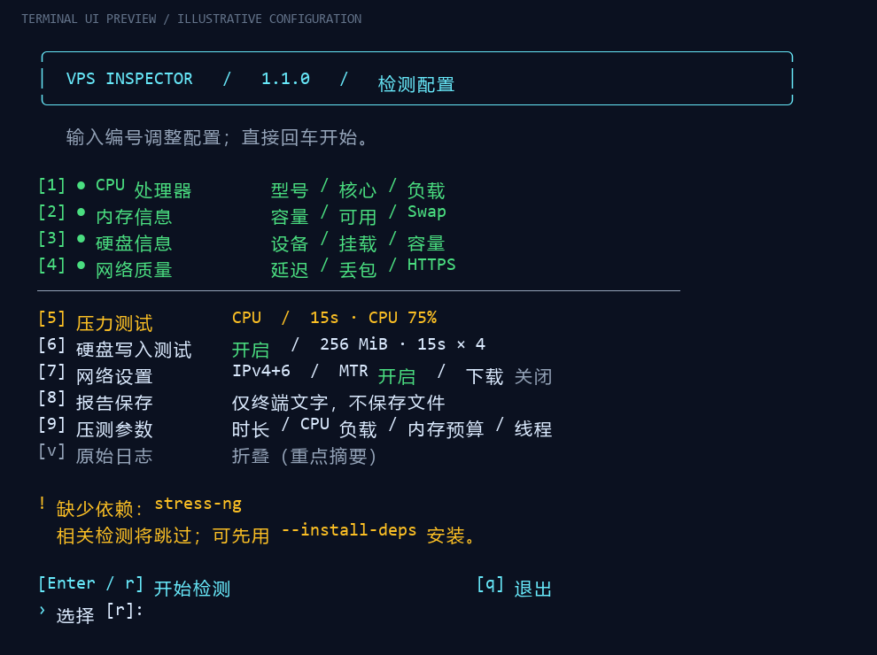
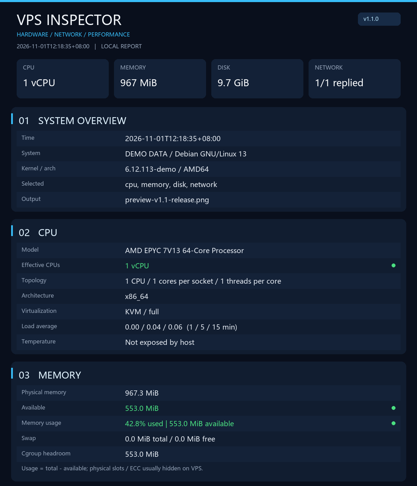

# VPS Inspector

一个独立实现的 Linux VPS 检测脚本，整合 CPU、内存、硬盘和网络基础质量检测。可交互选择项目，也可用参数运行。默认仅显示终端文字，报告只在进程内存中，不写 TXT/JSON、不上传报告。可选择将报告保存成 **VPS 本地 PNG**。

## v1.1 界面

交互模式采用中文编号菜单：`1–4` 开关检测模块，`5` 选择压测模式，`6` 配置硬盘写入测试，`7` 配置网络，`8` 选择 PNG 保存，`9` 调整压测参数，`v` 切换原始日志，回车开始。当前选择、测试预算和缺失依赖直接显示在菜单中；输入错误可以重新选择。

终端报告默认展示对齐的关键指标：CPU、内存使用条、磁盘容量、网络平均延迟/丢包/抖动、HTTPS 耗时、硬盘吞吐和 IOPS。颜色区分完成、注意/跳过和失败；末尾统一汇总需留意的项目，不生成综合跑分。单个指标的颜色不代表整机健康认证。内存和文件系统占用达到 85% 提示注意、95% 标红。

原始 ping 逐包日志、完整 MTR 和工具输出默认折叠，添加 `--verbose` 或在菜单按 `v` 展开。终端自动启用 ANSI 颜色；重定向输出、`NO_COLOR=1` 或 `--color never` 时输出无颜色的文字。`--color always` 可强制颜色。中文按显示宽度对齐，终端过长的指标会省略，PNG 保留完整值。

PNG 使用深色分区、顶部关键指标和状态色，直接从结构化报告绘制，不是把终端文字平铺成截图。图片标签使用英文，避免服务器缺少中文字体；如果报告含中文路径，可安装 `fonts-noto-cjk`，脚本会优先使用可用的 Noto CJK 字体。

以下为**示例数据**的界面预览，不是实际 VPS 测速结果：




## 一行启动

需要 **Linux、Bash、Python 3.8+** 和 curl。普通检测不要求 root。适合 Debian / Ubuntu；其他 Linux 在依赖齐全时也可运行，不保证所有发行版的命令选项一致。

```bash
# 交互选择检测项目、压测、硬盘写入测试、网络测速和 PNG
bash <(curl -fsSL https://raw.githubusercontent.com/beiluoshimenxing/vps-inspector/main/check.sh) -N

# 默认：所有模块的轻量检查，不压测、不写测试文件、不保存报告
bash <(curl -fsSL https://raw.githubusercontent.com/beiluoshimenxing/vps-inspector/main/check.sh)
```

也可下载后运行，便于先审查代码和确认下载成功：

```bash
curl -fL https://raw.githubusercontent.com/beiluoshimenxing/vps-inspector/main/check.sh -o check.sh
bash check.sh --help
bash check.sh -N
```

GitHub 原始文件地址已经能实现一行启动，不依赖额外服务器。若想使用自己的短域名，把域名的 HTTPS 地址配置为返回 `check.sh` 的原始内容，或 302 到上述 raw 地址，再运行 `bash <(curl -fsSL https://你的域名) -N`。本项目没有占用或接管 `Check.Place`。

## 功能范围

| 模块 | 默认检测 | 需要主动开启 |
| --- | --- | --- |
| CPU | 型号、架构、核心/线程、虚拟化、负载、可见温度、有效 CPU 数 | stress-ng 压测、负载比例、时长和线程数 |
| 内存 | 总量、可用量、Swap、cgroup 可用预算 | stress-ng 内存压力和校验 |
| 硬盘 | 块设备、型号、旋转属性、文件系统、容量和挂载点 | fio 顺序读写、4K 随机读写、IOPS 和平均延迟 |
| 网络 | IPv4/IPv6 ping 丢包/延迟/抖动，HTTPS DNS/TCP/TLS/首字节耗时 | TCP/443 去程 MTR、自定义 HTTPS 下载采样 |
| 报告 | 终端文字，无报告文件 | 本地 PNG，不覆盖已有文件 |

虚拟机无法保证看到真实物理 CPU、内存槽位、ECC 或硬盘 SMART，因此不编造这些数据。此版本不提供原帖全部功能：不包含 Geekbench、GPU 跑分、IP 风险评分、ASN/BGP 数据库查询、自动三网全国节点库、上传测速或真正的回程路由。可重复传入 `--target` 检测自己维护的电信/联通/移动测试节点；节点代表性由使用者判断。

MTR 测的是 **VPS 发往目标的去程**。中间路由器丢包可能只是 ICMP 限速，不能单凭它判定业务丢包。真实回程需要对端探针配合。HTTPS 下载是一个有上限的单连接样本，包含连接建立耗时，不等同于链路极限带宽。

## 自定义运行

下载 `check.sh` 后可使用以下命令；所有参数也可以直接接在一行启动命令末尾。

```bash
# 只看 CPU 和内存
bash check.sh --modules cpu,memory

# CPU 压测：30 秒，最多 2 个有效 CPU，负载 75%
bash check.sh --modules cpu --stress cpu --duration 30 --workers 2 --cpu-load 75

# CPU 与内存依次压测，每项 30 秒（不是同时压测）
bash check.sh --modules cpu,memory --stress cpu,memory --duration 30 --memory-mib 256

# 硬盘测试：务必选择想测的实际磁盘挂载目录
bash check.sh --modules disk --disk-bench --disk-dir /var/tmp --disk-mib 256 --duration 15

# 只测 IPv4，指定自己的多个节点；可用主机名或 IPv4/IPv6
bash check.sh --modules network -4 --target 1.1.1.1 --target dns.google --route

# 下载采样：请替换成你信任且允许测速的 HTTPS 文件源
bash check.sh --modules network --download-url https://your-server.example/test.bin --download-mib 10

# 报告图片只存 VPS 本机；父目录必须已存在，不能覆盖同名文件
bash check.sh --modules cpu,memory,disk --png "$HOME/vps-report-$(date +%Y%m%d-%H%M%S).png"
```

压测默认 15 秒、CPU 75% 负载。内存实际预算不超过 `--memory-mib`、可用内存 25%、保留 256 MiB 后的余量三者最小值；小于 16 MiB 就跳过。cgroup v2 会检查可见祖先限额，v1 支持常见控制器根目录；特殊 v1 嵌套布局可能无法识别，建议明确设置小预算。资源可能被其他进程同时使用，预算不是 OOM 的绝对保证。

硬盘测试会在指定目录创建唯一临时子目录，只测试其中的普通文件，不接受裸设备路径；预留测试大小之外额外 1 GiB 空间。先完整初始化测试文件（最多 120 秒），随后四项测试每项 `--duration` 秒，产生实际读写负载。默认 256 MiB 文件，正常退出、Ctrl+C 或 SIGTERM 后清理；SIGKILL、断电或内核崩溃无法保证清理，可能留下 `.vps-inspector-*` 目录，请核对后自行清理。禁止在业务高峰盲目开启压测。

下载默认最多读取 10 MiB 有效载荷、20 秒截止，不跟随重定向；即使服务器忽略 Range 也会切断读取，但传输缓冲、TLS/TCP 开销和在途数据可能额外消耗流量。默认目标为 Cloudflare 和 Google 公共 DNS，HTTPS 目标为 Cloudflare 网站，可通过 `--target`、`--http-url` 替换。ping 与 MTR 都有超时；无 IPv6、权限不足、依赖缺失或目标不可达会显示失败/跳过，继续其余检测。

## 依赖

基础信息大多来自 `/proc`、`/sys`、`lscpu`、`lsblk`、`df`。网络使用 `ip`、`ping`、`curl`；压力使用 `stress-ng`；硬盘性能使用 Flexible I/O Tester `fio`；路由使用 `mtr`；PNG 使用 Pillow 和 DejaVu Sans Mono。缺失的可选工具会跳过，PNG 缺少 Pillow 会在测试前报错。

Debian / Ubuntu 可以先安装全部可选依赖：

```bash
sudo apt-get update
sudo apt-get install -y python3 curl iproute2 iputils-ping util-linux stress-ng fio mtr-tiny python3-pil fonts-dejavu-core
```

或者在已具备 Python 3.8+ 的 Linux 中，**明确允许安装**：

```bash
sudo bash check.sh --install-deps -N
```

自动安装支持 apt-get / dnf / apk；发行版仓库可能缺少某些包，脚本不会私自启用额外软件源。默认运行不安装任何依赖。包管理器本身可能保留安装日志和缓存。系统日志、终端回滚、用户重定向或主机服务商的记录也不属于脚本的报告保存功能。

PNG 直接在内存中绘制，不生成中间 TXT/HTML，不调用云端截图服务。终端使用中文标签，PNG 使用英文标签。报告可能包含本机 IP、挂载路径和测试目标，请自行判断是否分享。

## 参数速查

`-N` 交互模式；`--verbose` 原始日志；`--color auto|always|never`；`--modules cpu,memory,disk,network`；`--stress cpu,memory`；`--duration 1..3600`；`--workers 1..256`；`--cpu-load 1..100`；`--memory-mib`；`--disk-bench`；`--disk-dir`；`--disk-mib 64..16384`；`--target`（可重复）；`-4` / `-6` / `--family both`；`--ping-count 1..30`；`--route`；`--http-url`；`--download-url`；`--download-mib 1..256`；`--png PATH`；`--install-deps`；`--help`。

`--modules` 限制检测范围，压测模块必须包含在其中。非交互模式不读取配置文件，不记住上次选择。交互模式通过 `/dev/tty` 读取选择，所以支持进程替换启动；没有终端时应使用参数。

## 开发与验证

`inspector.py` 是源代码；`python3 build.py` 将其嵌入 `check.sh`。发布后的 `check.sh` 是独立入口，不下载额外 Python 文件。

```bash
python3 build.py
bash -n check.sh
python3 -m unittest discover -s tests -v
bash check.sh --modules cpu,memory,disk
```

GitHub Actions 在 Ubuntu 上检查生成文件一致性、Bash 语法、参数保护、模块隔离、内存预算、硬盘临时文件清理、子进程超时和 PNG 输出，并执行无压测的硬件冒烟测试。测试不等同于在所有 VPS/文件系统/架构上完成兼容认证。报告中的 FAILED/SKIP 需要查看具体内容；进程返回 0 仅表示报告流程完成，非所有检测均成功。参数/前置条件失败返回非零，中断返回 130。

## 参考与许可

需求参考 [硬件质量帖子](https://www.nodeseek.com/post-584268-1) 和 [网络质量帖子](https://www.nodeseek.com/post-287967-1)，本项目是独立实现，不复制、包装或执行两个原脚本。两者的功能广度和成熟度不能视为本项目已经具备。

底层工具说明：[fio](https://fio.readthedocs.io/en/latest/fio_doc.html)、[stress-ng](https://github.com/ColinIanKing/stress-ng)、[MTR](https://github.com/traviscross/mtr)。本项目代码采用 MIT License，各外部工具遵循各自许可。
